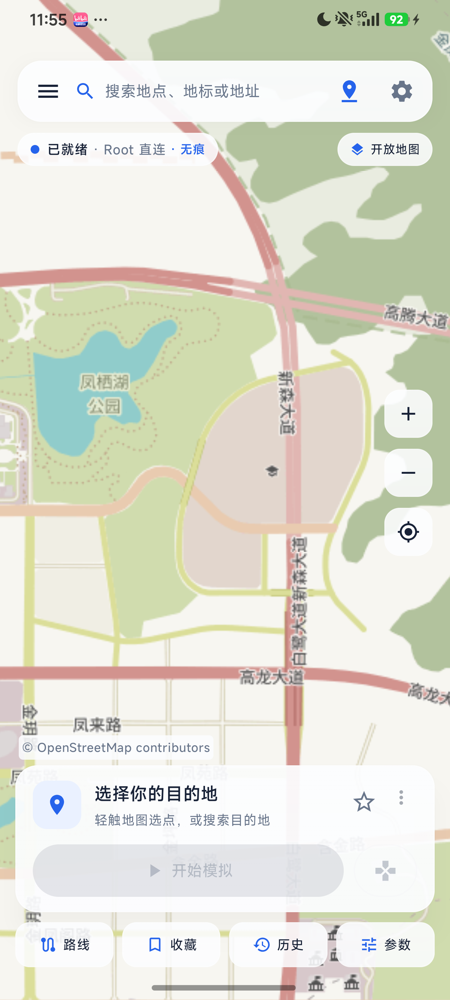
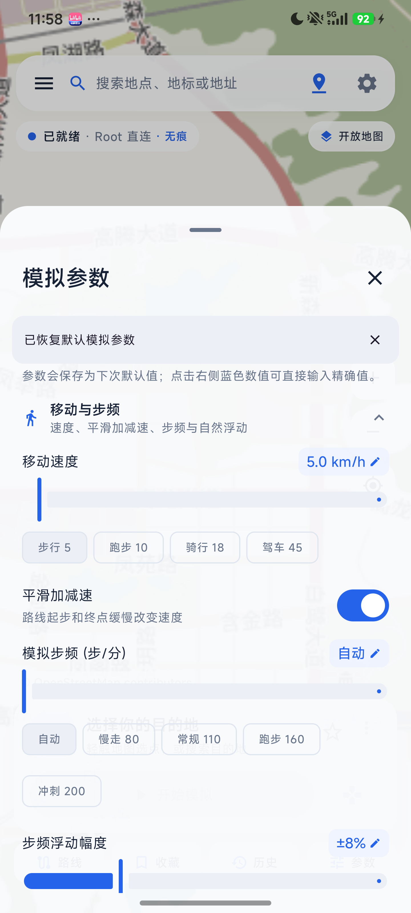
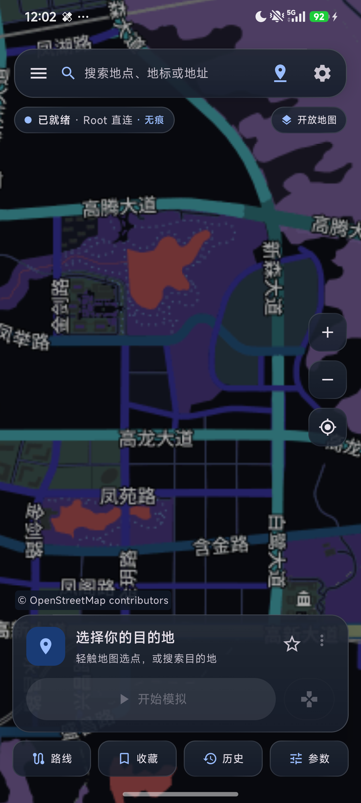
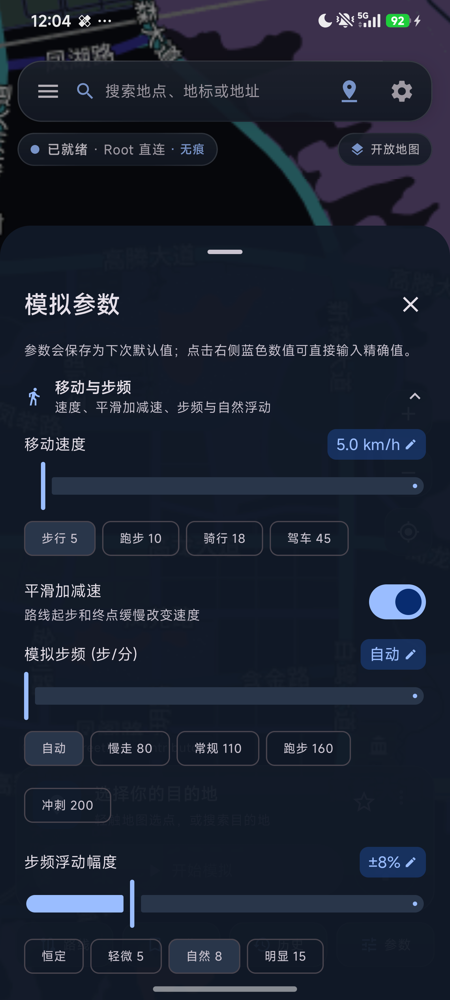

# Geostep

**定位 · 步频 · 轨迹** —— 面向开发与测试的 Android 位置 / 步频模拟工具。

Geostep 是 [jie8190/MockGeo](https://github.com/jie8190/MockGeo) 的重构分支：保留原有三种注入模式，补齐**可自定义步频（含自然浮动）**、**注入回读校验**、**Root 模式向第三方应用进程注入传感器钩子**，并重做品牌、构建说明与开发文档，便于开源协作。

<p align="center">
  
  
  
  
</p>

---

## 作者与致谢

- 作者：[GitHub @sayonara](https://github.com/lijh2007) · sayonara · 1590887927@qq.com
- 感谢原作者开源：[GitHub jie8190/MockGeo](https://github.com/jie8190/MockGeo) · jie8190 · kprxr.660@qq.com

## 这是什么

一个用于**机器人 / 自动驾驶 / 运动类应用联调**的模拟工具：按设定参数持续输出系统定位、GNSS 卫星信息与运动传感器（加速度、陀螺、旋转矢量、计步器等），让被测应用以为设备正按指定速度、指定步频移动。

它**不是**给普通用户刷步数或打卡的工具，请阅读文末的使用与责任声明。

## 界面

主界面、模拟参数面板与设置页均为仿 iOS 液态玻璃质感（半透明底 + 渐变描边 + 顶部高光），深浅色主题自动适配。

<p align="center">
  
  
  
</p>

<p align="center">
  
  
</p>

深色主题下玻璃底色会自动降到 16%/6% 白，仍保留描边与顶部高光，文字对比度不变。


玻璃效果在 `app/src/main/kotlin/com/geostep/app/ui/Glass.kt` 里实现：`Modifier.liquidGlass(...)`（卡片，92% 打底 + 16dp 双层柔光投影）与 `Modifier.liquidGlassChip(...)`（胶囊/小按钮，85% 打底）。Compose 无法对地图做真正的背景模糊，因此用「半透明表面色 + 上亮下暗白渐变 + 渐变描边 + 顶部 1dp 高光」做出等效观感。参数取值、扩展方式与三条使用规则见 [docs/UI_GLASS.md](docs/UI_GLASS.md)。

## 能力

| 能力 | 说明 |
| --- | --- |
| 界面 | 仿 iOS 液态玻璃：半透明玻璃卡片 + 渐变描边 + 顶部高光（`app/.../ui/Glass.kt`），浅色/深色主题都成立 |
| 三种运行模式 | 标准模式（系统模拟位置）、LSPosed 模式（系统级 Hook）、Root 直连模式（su 加载系统载荷） |
| 定位模拟 | 经纬度、海拔、水平精度、卫星数、同时模拟网络定位、GPS 位置漂移 |
| 轨迹模拟 | 路线 / 摇杆 / 正弦速度曲线，0.1–30 m/s |
| **步频模拟** | 自动（按速度推算）、固定 1–300 步/分、**±0–30% 自然浮动**（周期 10–120 秒） |
| 传感器注入 | 计步器、计步事件、加速度、线性加速度、重力、陀螺、旋转矢量、磁场等 11 类 |
| 静止真实 | 静止不出步数；固定步频也只在移动时生效；静止时由自驱动事件泵按步频继续出步 |
| 注入校验 | 开始后 2.5 秒首检、之后每 10 秒回读模块上报的坐标 / 速度 / 步频，不一致直接提示 |
| 第三方 App | Root 模式下可把传感器钩子注入指定应用进程（实验特性） |
| 低功耗模式 | 设置里一键开启：模拟刷新降到 2 秒一次、地图降采样与单线程下载，适合低端机长时间挂机 |
| 结构 | 组件化拆分（参数面板分组、横幅与校验条、注入控制器、参数边界、诊断报告各自独立） |
| 机器人友好 | 控制面走 `sendExtraCommand`，状态列可回读实际生效的 `speed_mps` / `cadence_spm` |

## 三种运行模式

| 模式 | 需要什么 | 模拟位置 | 模拟步频 | 适用场景 |
| --- | --- | --- | --- | --- |
| 标准模式 | 开发者选项里把 Geostep 设为“模拟位置信息应用” | 是 | 否（不注入传感器） | 快速验证定位逻辑 |
| LSPosed 模式 | 已 Root + LSPosed，启用模块并勾选作用域 | 是 | 是 | 需要“位置 + 传感器”一致的应用 |
| Root 直连模式 | Magisk / KernelSU / APatch 等 su 授权 | 是 | 是（需对目标 App 注入一次） | 不想装框架；可精确注入指定 App 进程（不写 system_server） |

> 三种模式互斥：同一时间只有一个注入引擎生效，切换前需先停止模拟。

## 安装

从 Releases 下载：

* `Geostep-<version>-app.apk` —— 主应用
* `Geostep-<moduleVersion>-module.apk` —— LSPosed 模块（仅 LSPosed 模式需要）

包名 `com.geostep.app` / `com.geostep.module`，与旧版 `com.mockgeo.*` 是**不同应用**：升级前先在旧版导出配置，装好 Geostep 再导入。

## 快速开始

### 标准模式

1. 系统设置 → 开发者选项 → 选择模拟位置信息应用 → Geostep。
2. 打开 Geostep，地图选点或搜索目的地。
3. 点「开始模拟」，在「模拟参数」里调速度与步频。

### LSPosed 模式

1. 安装 `Geostep-...-module.apk`。
2. LSPosed 管理器里启用该模块，勾选要生效的应用（被测 App 必须包含在内）。
3. 打开 Geostep → 偏好设置 → 运行模式 → LSPosed 模式。
4. 重启被测应用，再点「开始模拟」。

### Root 直连模式

1. 打开 Geostep → 运行模式 → Root 直连模式，按提示授予 su。
2. 点「开始模拟」。模拟参数由 App 每 3 秒写到 `Settings.Global.geostep_state_v1`（15 秒过期），不需要额外装模块。
3. 若还要让第三方运动类 App 读到位置+步频：**先打开目标 App**，回到 Geostep →「模拟参数」→「Root 传感器注入（实验）」→ 填包名（例如 `com.lptiyu.tanke`）→ 注入。

> 注入是“打进正在运行的进程”：目标 App 被杀掉或更新后钩子消失，需要重新注入。
> 已实测：注入后目标进程日志出现 `app-scope hooks installed`，探针 App 收到间隔 495–510ms 的
> `TYPE_STEP_DETECTOR` 事件（对应 120 步/分）。细节与排障见 [docs/ROOT_APP_INJECTION.md](docs/ROOT_APP_INJECTION.md)。

## 步频怎么算

| 设定 | 行为 |
| --- | --- |
| 自动（0，默认） | `stride = 0.42 + 0.23 × v`，步频 = `v × 60 / stride`，夹在 40–300 步/分。1 m/s 约 92，3 m/s 约 162 |
| 固定 N | 移动中按 N 步/分计步；静止不出步 |
| 浮动 ±P%，周期 T | 在 N 上叠加两条正弦（`0.62·sin(2πt/T) + 0.38·sin(2πt/0.41T + 1.7)`），**纯确定性函数**，App 与模块算出同一个值，回读校验不会误报 |

计步事件间隔 = `60000 / 瞬时步频` 毫秒（下限 80ms），计步器按瞬时步频积分，波形相位与步事件同相。

第三方运动 App 读不到步数时，先确认它走的是 `SensorManager`（可注入）而不是 Health Connect / 厂商健康服务（不可注入），详见 [docs/STEP_CADENCE.md](docs/STEP_CADENCE.md)。

## 构建

环境：JDK 17、Android SDK（platform 36、build-tools 35+）、NDK 27.0.12077973、CMake 3.28+、Gradle 8.14.3。

```bash
# 1. 本地配置（local.properties 不在版本库中）
echo sdk.dir=/path/to/android-sdk > local.properties

# 2. 完整构建（需要 NDK/CMake 编译原生件）
./gradlew :app:assembleDebug

# 3. 只复用已有原生件（跳过原生编译，适合 CI 或未装 NDK）
./gradlew :app:assembleDebug -PprebuiltNative=true
```

`-PprebuiltNative=true` 会跳过 `:core:engine` 的 CMake 编译，改用 `core/engine/src/main/jniLibs/arm64-v8a/libmockgeo_art.so`；该预编译件不进版本库，请自行构建或从 Release 包中提取。

Root 载荷单独构建：

```bash
./gradlew :rootpayload:buildRootNative   # 产物在 rootpayload/build/root-native/stripped/
```

常见坑：

* 工程路径**不要包含中文**。CMake/ninja 会按本地编码解码路径导致 `missing and no known rule to make it`；无法避免时保留 `android.overridePathCheck=true` 让 AGP 放行。
* 受限沙箱（禁止命名管道）里 ninja 会挂在 jobserver 上不退出，可用 `-x :rootpayload:buildRootNative` 跳过原生任务。
* Release 默认沿用 debug 签名，正式发布请替换为自有 keystore。

## 目录结构

```
app/            主应用（Compose UI、地图、模式选择、注入校验）
module/         LSPosed 模块（进程内传感器 / 证据钩子、状态上报）
rootpayload/    Root 载荷（LSPlant + Dobby + xDL，注入 system_server 或指定 App）
core/model/     控制面协议、SimConfig、StepCadence（App 与模块共用的纯逻辑）
core/engine/    注入引擎（ProviderEngine / XposedEngine / RootEngine / EngineRouter）
core/data/      设置与历史（DataStore + Room）
core/route/     轨迹生成与速度曲线
probe/          注入诊断探针
docs/           设计与验证文档
```

## 测试

```bash
./gradlew :core:model:test :core:route:test :core:data:test :module:testDebugUnitTest \
    :core:engine:testDebugUnitTest :app:testDebugUnitTest
```

当前 263 个单元测试（module 78、core:engine 65、core:route 47、core:model 25、app 14、core:data 9），覆盖步频曲线与浮动边界、回读校验判定、计步器累计语义、镜像协议解析、低端设备降级预算等。

## 控制面协议（脚本 / 机器人集成）

* 命令：`LocationManager.sendExtraCommand("geostep", "set", bundle)`，常用键 `lat/lng/alt/accuracy/speed/bearing/satellites/step_cadence_spm/step_cadence_variability_pct/step_cadence_period_sec`
* 回执：模块写入应用内 status provider，并镜像到 `Settings.Global` 的 `geostep_state_v1`（JSON，键 `e/h/lat/lng/spd/sat/ts/et/boot/session/alt/brg/cad/cav/cap/x`）
* 回读列：`speed_mps`、`cadence_spm`（旧模块缺列时读作 NaN / -1）

细节见 [docs/WORK_MODES.md](docs/WORK_MODES.md)、[docs/STEP_CADENCE.md](docs/STEP_CADENCE.md)。

## 参与贡献

见 [CONTRIBUTING.md](CONTRIBUTING.md)。提交前请确认 `./gradlew` 的单测全绿，并保持代码风格与既有分层一致。

## 使用与责任声明

本项目用于定位技术学习、研究及**已获授权**的测试与调试。维护者不支持、不鼓励，也不提供用于违法违规、欺诈或侵害第三方合法权益的技术协助。使用者应遵守适用法律法规、授权范围及相关 App、小程序和平台的服务规则。

如经核实存在利用本项目实施违法违规行为，或相关 App、小程序运营方、权利人反馈权益受损，维护者将停止更新，并视情况关闭仓库访问或删除仓库。

## 许可证

[Apache License 2.0](LICENSE)。本仓库源自 MIT 许可的 jie8190/MockGeo，原作者版权声明与第三方组件许可见 [NOTICE](NOTICE)。


## 开源交付

- [docs/OPEN_SOURCE.md](docs/OPEN_SOURCE.md)：开源交付说明（哪些进仓库、怎么构建、许可、发布流程）
